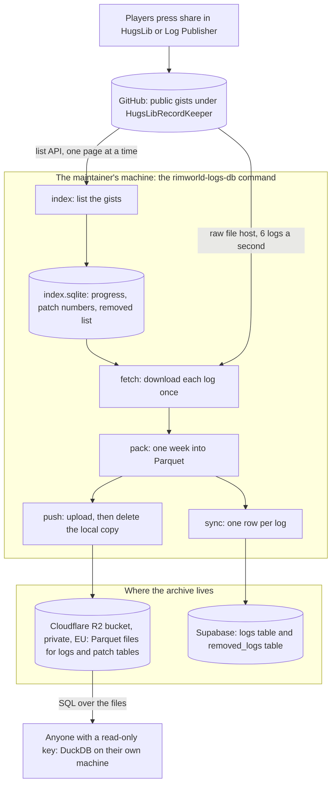
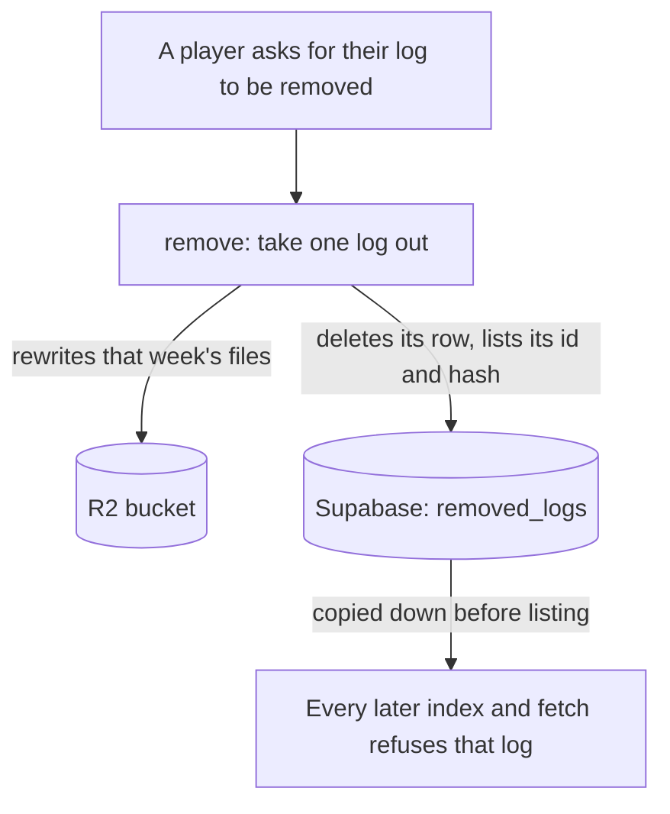

# How it fits together

Logs start as public gists on GitHub. One command-line tool copies them into two stores, and everyone who uses the archive reads from those stores with DuckDB. Nothing runs as a service.

Removing a log is a separate, short path. It ends in the removed list, which every later listing reads first:

## The pieces

**GitHub** is the source. HugsLib and the standalone Log Publisher upload every shared log as a gist under one account, and the puller only ever reads from it.

**The puller** is the Python package in [src/rimworld_logs_db](../src/rimworld_logs_db), which the maintainer runs as the `rimworld-logs-db` command. It works a week at a time: download that week's logs, pack them into Parquet, upload, delete the local copy. Its working state is a single SQLite file. [maintaining.md](maintaining.md) maps each step to its module.

**The R2 bucket** holds the data: one log file and four patch-table files per upload week, plus a backup of the puller's SQLite file. It is private, and Cloudflare does not charge for reads.

**Supabase** holds two small tables. `logs` has one row per log with its parsed facts and no text. `removed_logs` is the list of logs taken out on request.

**Readers** run DuckDB on their own machines with a read-only key to the bucket. The five views in [sql/views.sql](../sql/views.sql) read the Parquet files directly.

## What lives where

| Place | Holds | Who can reach it |
|---|---|---|
| GitHub | the original gists | anyone |
| The maintainer's machine | `index.sqlite`, and one week of logs while it is being processed | the maintainer |
| R2 bucket | every log's text, the patch tables, a backup of the index | the maintainer's key to write, read-only keys for collaborators |
| Supabase | the `logs` and `removed_logs` tables | members of the project |
| A reader's machine | a DuckDB file of views, plus any copies they make | that reader |

## Why it is shaped this way

- **Files in a bucket, not a database server.** A log averages about 4,000 Harmony patches, so two years is roughly a billion patch rows. Sorted and delta-encoded in Parquet they take about a fifth of a byte each. In a row-store database the same table would be tens of gigabytes.
- **R2 for the files.** People scan the whole archive, and each full read is several gigabytes. R2 has no charge for data read out of it.
- **Supabase for the small tables.** One row per log fits its free tier, and it gives a place to look up a single log without downloading anything.
- **A week at a time.** The full set is larger as text than the disk of the machine that builds it, so a week is uploaded and deleted before the next is fetched.
- **The removed list lives in Supabase, not in the puller's own file.** That file can be lost and rebuilt from nothing. A rebuilt index has to refuse removed logs, so it copies the list down before it lists anything.
